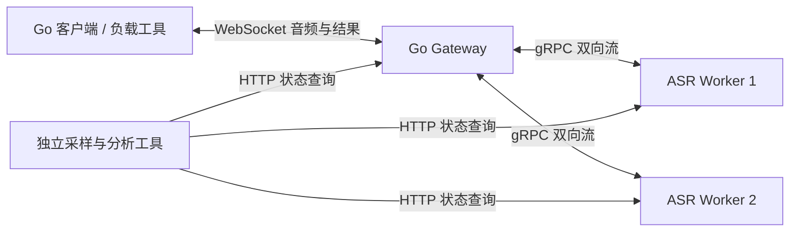

# Tide

**面向长时临床对话的实时语音流式处理系统。**

Tide 的业务背景是 AI 医生助理：在问诊过程中实时转录医患对话，问诊结束后根据完整对话生成病历草稿，供医生确认和修改。本仓库聚焦其中的 ASR 流式后端，使用 Go 构建客户端与语音识别服务之间的双向流式链路，承载持续的音频输入与识别结果返回。

一次问诊可能持续数十分钟，多个会话同时运行时，还会遇到下游处理变慢、连接中断和资源回收等问题。项目围绕这些问题，实现长连接生命周期管理、背压与容量控制、会话级 Worker 分配和有限断线恢复，并通过可控负载与故障实验评估完成率、延迟、资源占用及恢复表现。

## 系统结构



Gateway 管理连接与会话、控制音频积压，并为新会话选择 Worker；Worker 通过 gRPC 双向流接收音频，返回处理进度和识别结果。当前使用可控 Mock Worker，后续通过适配器接入真实 ASR 模型。

每个会话绑定一个 Worker，并持续使用同一条 gRPC 流。客户端与 Gateway 之间提供两版 WebSocket 应用协议：默认使用的 v1 支持基础流式传输，显式启用的 v2 增加会话保留、音频补发和结果去重，使客户端短暂断线后可以接回原会话。恢复依赖原 Gateway 会话和 Worker 流仍然存活，并受时间与缓存预算限制。

启用方式与恢复机制见[运行文档](docs/command.md#v2-会话恢复)，验证入口见[恢复测试](docs/testing.md#同一会话多次断线)。

## 当前能力

| 能力 | 实现范围 |
| --- | --- |
| 双向流与生命周期 | 音频持续上传、结果实时返回；输入结束后接收尾部；异常、超时和服务停止时协调任务退出 |
| 背压与等待保护 | 单实例会话准入、未完成处理音频的字节预算、发送/处理等待/尾部/结果写回期限；v2 音频与结果缓存有界 |
| Worker 分配 | 普通轮询、静态平滑加权轮询；每个后端复用 gRPC ClientConn，按新会话选择 |
| 有限恢复 | v2 会话身份与连接代次、音频确认与重放、结果序号与确认、尾部完成协议；累计或可选滑动尝试额度、可选 jitter |
| 观测与实验 | 有限并发负载、Gateway/Worker 状态采样、可控故障、逐事件记录、独立分析与证据归档 |

第一至第三阶段的链路与基础生命周期已验收；第四阶段核心保护已实现，严格资源边界仍待验证；第五、六阶段已完成当前 Mock 范围的调度与恢复验收。下一步是第七阶段的真实 ASR 契约评审与适配。详细进度见 [Milestones](docs/MILESTONES.md)。

## 快速开始

需要 **Go 1.26 或兼容工具链**，首次运行需取得 `go.mod` 中的依赖。下列命令从仓库根目录执行，使用 macOS/Linux shell；不需要 GPU、外部 ASR 服务或音频文件。生成的 protobuf Go 文件已经入库，运行示例不需要安装 `protoc`。

分别打开三个终端，进入仓库根目录，依次执行以下命令。默认使用 `50051`（Worker）和 `8080`（Gateway）端口。

**终端一：启动 Mock Worker。**

```sh
go run ./cmd/asr-worker
```

**终端二：启动 Gateway。**

```sh
go run ./cmd/gateway
```

**终端三：运行两场、每场两秒的静音音频。** 等待前两个终端显示服务启动成功后执行：

```sh
go run ./cmd/loadgen \
  -sessions=2 \
  -audio-bytes=64000 \
  -expected-final-text='今天天气不错' \
  -output=/tmp/tide-smoke-001.json
```

客户端默认连接 `ws://localhost:8080/v1/asr`，按实时节奏发送音频。成功时日志显示 `loadgen completed`，报告中两场均为 `completed`。Mock 返回预设文本，与静音输入内容无关。

查看报告：

```sh
cat /tmp/tide-smoke-001.json
```

为保留已有结果，负载工具拒绝覆盖文件；再次运行时换一个输出文件名，例如 `tide-smoke-002.json`。完成后，在两个服务终端按 Ctrl+C 停止服务。

这个示例使用默认配置跑通基本链路。积压预算、多 Worker、状态查询与独立采样的配置见[运行命令](docs/command.md)。

## 已有实验结果

以下实验通过可控 Mock Worker 固定下游处理条件，对比不同调度与恢复策略下的完成率、请求开销和延迟表现。各项结果对应独立的实验条件，具体配置与验证范围见关联报告。

| 问题 | 条件与结果 | 证据 |
| --- | --- | --- |
| 异速后端的分配是否合理 | 同两个 Mock Worker、12 并发、20 秒、各三批，轮询 **30/36 → 加权 36/36** 完成，增加 16.7 个百分点 | [调度策略对照](docs/experiments/strategy-comparison.md) |
| 短暂断网能否继续原场 | 六秒输入、500ms 中断，关闭/开启恢复各三场，完整完成 **0/3 → 3/3** | [单场恢复对照](docs/worklog/2026-10-09-client-resume-baseline-results.md) |
| 群体重连能否减少争抢 | 八场同时断线、入口占位 500ms，固定退避/jitter 各四批，均 **32/32** 完成，请求 **144 → 129（−10.4%）** | [jitter 对照](docs/worklog/2026-10-12-group-resume-jitter-results.md)；2s 占位时典型等待反而增加，不能只看请求收益 |
| 长会话能否重新获得恢复机会 | 十分钟、六轮断线、同为五次额度，整场累计/最近 60s 各两场，完整完成 **0/2 → 2/2**；滑动组每场处理 **19,200,000B、6001 条结果** | [预算策略对照](docs/worklog/2026-10-14-recovery-budget-comparison-results.md)；时间/资源质量 **3/4**，降级场保留，未证明延迟优化 |

实验预先固定输入、故障、参数和判据，保留成功、失败及质量降级样本；报告链接到原始事件、配置、源码快照与分析产物。完整完成、预期保护行为和数据质量分别判断。

## 测试与开发

```sh
make help
make test-fast   # audio 与 workerpool 两包的快速检查
make test        # 全项目默认 Go 测试，含本地网络与进程测试
make test-race   # 全项目默认测试加竞态检测，按包串行
make test-tools  # Python 3 实验工具正确性测试
```

默认测试包含短场故障验证，正式长时实验需要显式启用；测试耗时不作为性能指标。Python 工具使用标准库，部分正式实验依赖 macOS 的运行环境和睡眠审计，执行前需阅读对应方案。范围、定向入口及显式实验开关见[测试说明](docs/testing.md)。

```text
cmd/                       服务、客户端、负载与采样命令
internal/gateway/          会话生命周期、流量保护、v1/v2 接入与恢复
internal/wsclient/         客户端流式传输、音频重放与恢复协调
internal/wsprotocol/       WebSocket 消息与协议类型
internal/workerpool/       会话级 Worker 选择
internal/mockasr/          可控处理速度与容量的 Mock Worker
internal/audio/            PCM 格式与发送节奏
internal/loadgen/          有限负载、观测、采样与报告
proto/tide/asr/v1/         gRPC 流式接口及生成代码
docs/adr/                  架构决策及取舍
docs/worklog/              设计、实现与验收记录
docs/experiments/          实验方案、脚本和归档结果
```

## 当前边界与后续工作

- **真实模型待接入。** 识别准确率、说话人区分、模型追赶能力及计算资源消耗尚未评估。处理进度必须表示连续音频已完成处理，不能用网络发送成功或入队成功代替。
- **恢复依赖原场存活。** Gateway 注册表和保留数据在内存中，原 Worker 流不可重建；实例状态丢失后旧场明确失败，新场需显式创建。
- **资源与容量结论有限。** 已验证部分固定场景的预算、自然清理与资源走势；严格整进程内存上界、数十分钟临床负载、更广弱网和群体反复恢复仍有证据缺口。
- **调度与部署仍是开发范围。** 静态权重不提供动态健康剔除或自动调权；当前命令使用明文 WS/gRPC，Gateway 固定监听 `:8080`，尚未形成完整的生产部署方案。

继续阅读：[阶段进度](docs/MILESTONES.md) · [架构决策](docs/adr/README.md) · [第六阶段总结](docs/worklog/2026-10-14-stage-six-summary.md) · [运行命令](docs/command.md) · [测试说明](docs/testing.md) · [文档约定](docs/README.md)
